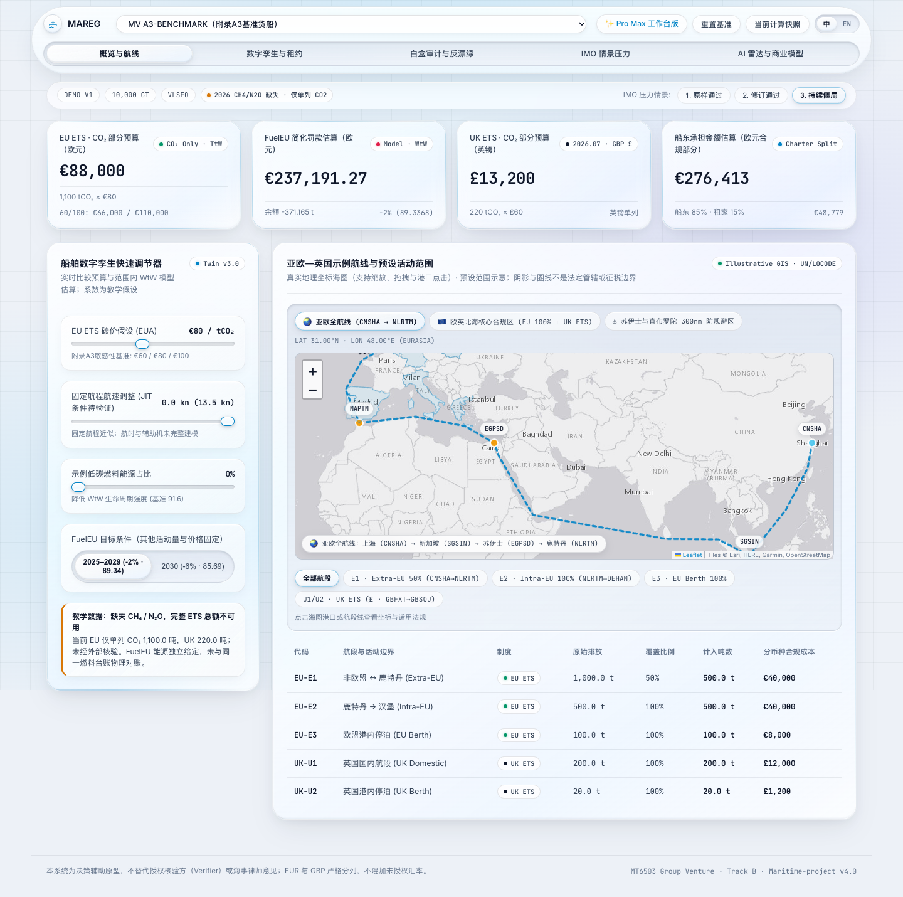
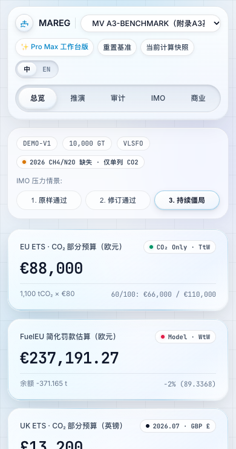
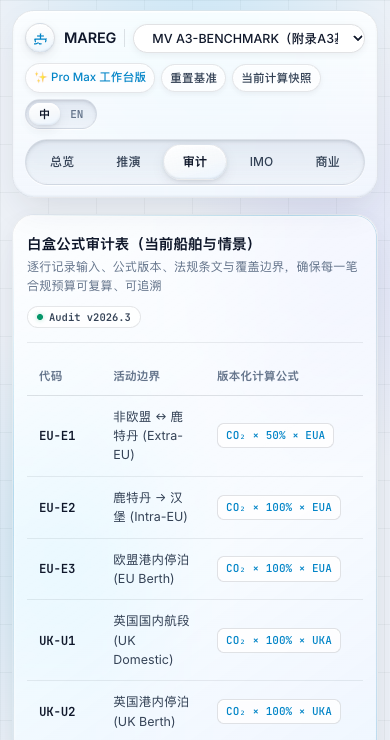

# Delivery verification · original UI retained

Final scope follows the user's request to retain the existing visual and motion design and avoid excessive checks.

Completed:

- 9 core calculation regression tests passed, covering A3 values, positive balances, baseline identity, pooling limits, repeated deficits and negative client economics.
- One bounded Chrome page smoke check passed: baseline figures, surplus vessel, JSON snapshot, native Escape close, reset while the map was hidden, and desktop/mobile layout.
- No page runtime errors in that smoke check.
- Original `styles/tokens.css` is unchanged. The original `styles/main.css` content is retained with appended responsive layout/modal-sizing rules; original effect definitions and timing values were not replaced.

No further full-site scan or broad compatibility audit was performed after the user's latest instruction. Real-vessel verification, Safari/Firefox and full WCAG certification remain outside this verification scope.





## Mobile layout follow-up

One focused browser session checked 320/390px Chinese/English tab and context containment, immediate content visibility when switching the five mobile views, continued IMO-control availability, and desktop summary retention. No page runtime errors were observed. No calculation or broad browser suite was rerun for this layout-only change.




## v4.1.0 customer-content delivery · 2026-10-15

One focused Chrome desktop (1440px) / mobile (390px) session passed:

- New bilingual five-tab navigation, demo notice and the unchanged €88,000 / €237,191.27 baseline.
- Input-linked comparison delta, collapsed/open calculation trace and seven official reference links.
- Future scenario selection leaves regional budgets unchanged and shows no venture break-even figures.
- Preset customer FAQs in Chinese/English, native snapshot export containing `uiVersion: 4.1.0` and `etsComplete: false`.
- Mobile navigation/float, page-width containment and the flat quick adjuster; no page runtime errors.

Desktop/mobile screenshots were inspected locally. Source syntax and whitespace checks passed. No new calculation-engine changes, repeated full suites, live-vessel validation or cross-browser certification were performed. Source/reference dates are retained from the prior review, not a new regulatory audit.


## v4.2.0 scoped planning and desktop float · 2026-10-15

Passed the existing nine engine checks and five focused planner/accounting checks. New checks cover independent extra-time/auxiliary-cost calculations, party accounting identities, time/fuel limits, confirmed versus uncertain supply, uneconomic pooling and non-grid fuel caps. No additional repeated broad suites were run.

One Chrome desktop (1440px) / mobile (390px) interaction session passed: original budget values, desktop automatic floating budget and mouse drag/collapse/reset, input drafts and native required-field validity, editable UK price, six option rows, constraint violations, conditional candidate loading, GENCON/NYPE allocation without changing total, bilingual labels, snapshot versions and applied input/search provenance, mobile containment and vessel/reset behavior. No page runtime errors. Screenshots were visually inspected; Google Fonts were blocked in the check to avoid external font-loading delay. This is not a live-data, regulatory, full accessibility or cross-browser audit. Final table ordering prioritizes scoped total and party amounts; component columns remain horizontally scrollable.


## v4.2.1 · Stage 1 · 2026-10-16

Baseline: **light-v4.2.0-baseline-2026-10-16** (`05cd7de`).

实际执行 / Commands actually run:

```sh
npm test
CHROME_PATH='/Applications/Google Chrome.app/Contents/MacOS/Google Chrome' BASE_URL=http://127.0.0.1:48179 node tests/stage1.mjs
node --input-type=module --check < js/app.js
node --check js/planning-ui.mjs
git diff --check
git diff --exit-code light-v4.2.0-baseline-2026-10-16 -- js/compliance-engine.mjs js/data-and-i18n.js js/app-pro-max.js index-pro-max.html styles/pro-max.css
```

`npm test` 实际运行一次：14 tests, 14 pass, 0 fail。完整输出保存在 [npm-test.txt](verification/v4.2.1/npm-test.txt)。基准值及引擎 SHA-256 逐项相同，默认 planner 结果做了 deep comparison。未改引擎函数、共享数据或 Pro Max 源码。

浏览器检查第一次在固定列位置断言处失败；随后仅把检查改为鼠标移开并等待保留的 hover 动画稳定后测量，第二次运行通过。未因此修改产品动效，两个日志均保留。未重复运行 npm test。

- 1440: table clientWidth/scrollWidth = 1246/1246；768: 674/674；均五列且无需横滚。
- 375: 321/508，仍为表格内部横滚；全部列可展开为 11 列，首列固定。
- 三种宽度均断言 E1/E2/U1 所有坐标在默认视野内，且本地 242 个国家要素加载，EU27 使用 accent 阴影、GBR 单独着色，法国 ISO_A2 确认是 -99。
- 窄屏“滑块 → 分摊 → 推荐 → 表格”顺序通过；推荐和载入按钮仍在右栏对应卡片。
- 0% 无圆弧；非零最小长度为 251×3%=7.529999999999999; 正向增量为 warn，下降为 accent，超过 ±30% 封顶，重播使用相同映射；中英文 aria 说明已检查。
- 12 个外部链接逐个触发新标签页，原页 URL 和已调整金额不变；公式主体默认展开；2030 显示 85.6904。
- 通过请求拦截屏蔽字体、底图等外部域名，仍断言本地航线、国家阴影、金额、台账正常。**通过请求拦截模拟，不是真实离线，也不保证未缓存时首次打开。**
- Pro Max 冒烟通过：页面、Leaflet 图层及交互计算正常；ukEtsPrice 从 60 改为 70 后，UK 显示从 £13,200 到 £15,400，证明该共享变量仍被其使用。测试将其 Leaflet CDN 请求替换为仓库未修改的 1.9.4 文件；未验证 CDN 可达性。
- 成功运行未出现 pageerror；前后截图已查看。仅 Chrome，未扩大为跨浏览器或真实离线审计。

[原始数据、日志与基准对照](verification/v4.2.1/README.md) · [三种宽度的前后截图](previews/v4.2.1/README.md) · [评审核实及不准确之处](REVIEW_STAGE1.md)


## v4.3.0 · Readability · 2026-10-16

Baseline: `light-v4.2.1-baseline-2026-10-16` (`cdec884`). Only Chrome. 本阶段评估过清爽模式，按用户决定取消；不提供该功能。性能对比、中位数、GPU 评估和性能预算按后续指示取消，不给性能结论。原先异常数据仅保留在本地 test-results。

实际命令与结果：

```sh
node tests/stage2-lab.mjs baseline
node tests/stage2-lab.mjs baseline --resume
node tests/stage2-lab.mjs consolidated
node test-results/stage2/compare-css.cjs
python3 test-results/stage2/implement.py
node tests/stage2-lab.mjs after
python3 test-results/stage2/pixels.py
npm test
node tests/stage2.mjs
node test-results/stage2/final-screens.cjs
node --input-type=module --check < js/app.js
git diff --check
```

初始采样脚本在选择隐藏模块 summary 时失败；已完成的性能样本没有重跑，后续只恢复采样。一次恢复脚本出现重复声明语法错误，修复后采样完成。随后按用户取消决定移除了该脚本的性能部分，因此历史 --resume 命令只是执行记录，不是当前脚本的推荐复现方式。取样点、截图和 axe 结果均为真实运行所得。

纯 CSS 整理首批截图存在指针/地图动画时刻差异；以新页面、固定动画时刻、等待地图原有动画结束做成对比较后，1440/768/375 的不同像素数均为 0，组件计算样式一致。仅 CSS 提交为 `86d3f20`，文字/交互修改在独立提交。未为截图差异删除原有动效。

`npm test` 仅运行一次，14 pass / 0 fail，真实完整输出保存在 [npm-test.txt](verification/v4.3.0/npm-test.txt)。`tests/stage2.mjs` 内实际执行受保护五文件 `git diff --exit-code` 一次，exit 0、输出为空；默认六项金额旧/新一致。180 帧连续 input 最终 €132,000，通过；中英文×三宽布局通过；sticky 阅读区偏移 0，标题仍倾斜，KPI 原强度与减少动态行为通过；弹窗更新而不重复绑定；Pro Max 冒烟通过。外网请求在测试中阻断，Pro Max 的 Leaflet CDN 请求用未修改的本地同版本文件替代，未验证 CDN 可达性。主动阻断产生的资源加载错误不作为应用错误。

最终六张截图第一次可能捕捉到尚未结束的 850ms 地图飞行动画，因此只重拍截图并等待 1100ms；没有重跑 npm、受保护 diff 或整套可靠性检查。截图中的无限光斑在固定动画时刻暂停，仅用于可比截图，不是默认产品行为。发布链接在 Release 创建后再启用，预发布截图页脚仍指向旧 Release。

像素取样不只用令牌：隐藏文字墨迹而不改布局/材质，在第一行文字中心取 3×3 实际背景中位色，记录视口点与 PNG。7 组改前/改后样本的改后对比度均 ≥4.5:1；不覆盖页面所有可能背景。axe-core 4.10.3 检测确定违规均为 0，passes 均 28；仍有 aria-prohibited-attr、color-contrast、link-in-text-block 三类 incomplete（颜色节点改前124/改后125）。axe 无官方百分制评分，未虚构分数，也不声称认证通过。

纠正过的评审判断：缓存已在阶段1统一为4.2.1；徽章正文实际是 secondary；Chrome 顶栏最终为普通 blur、导航与 KPI 才使用折射。保留默认光斑与折射的决定不变。无高对比度自动模式；不支持 blur 的回退只有一小段 @supports not，本机 Chrome 支持 blur，未实测不支持 blur 的浏览器。

[完整证据、基准表、含像素坐标的对比度表、缓存位置及人工项](verification/v4.3.0/README.md) · [中英文三宽截图](previews/v4.3.0/README.md)


## v4.3.1 · Input simplification · 2026-10-18

基线 `light-v4.3.0-baseline-2026-10-18` (`04c4dc5`)。范围 **仅 Chrome**。五项快速输入与高级分组保留全部 14 原字段和约束，吨数只是 MJ 的显示换算。没有修改引擎、搜索算法、Pro Max、商业数值；没有性能评估或哈希工作。

实际运行：

```sh
npm test
node tests/inputs-ui.mjs
node tests/inputs-boundary.mjs
node --check js/planning-ui.mjs
node --input-type=module --check < js/app.js
git diff --check
git diff --exit-code light-v4.3.0-baseline-2026-10-18 -- js/compliance-engine.mjs js/data-and-i18n.js js/app-pro-max.js index-pro-max.html styles/pro-max.css
```

- 另实际执行两段内联 Playwright 脚本：修改前导出 v4.3.0 快照；主流程后仅补查八个标签的最终键盘焦点，结果保存为 `keyboard-tags.json`。
- `npm test` 一次：17 tests / 17 pass / 0 fail；新增 3 项换算、边界及真实引擎一致性测试。完整原始输出见验收目录。
- 受保护文件 diff 一次：exit 0，空差异；不做哈希。六项默认金额逐项相同。
- 默认可见数值输入 5 个；高级展开共 15 个单位视图（14 个原字段 + 1 个等效吨输入）。全部原 min/max/step 未变。
- 默认快照除 `uiVersion`、`generatedAt` 外深度相同，吨数不入快照。默认值演示确认不改变 comparison；三个确认标志均为 true，重置均回到 false。
- 双向换算、未应用草稿提示、默认还原、空值／越界及非整数 MJ 错误、说明 focus/Esc、折叠、预设与确认通过。30 帧滑块连续输入正确更新到 €132,000；这是通过／失败检查，不是性能测量。
- 主流程对标签的逐项最终焦点断言不够明确，补做了一次仅限八个标签的键盘断言，均通过；已将明确断言写回检查脚本。
- 大能源量的浮点往返采用与数值量级匹配的舍入误差容差；之后只补查 1000、1001、999999999999、1000000000000 MJ，以及演示默认／重置标志，未重跑整个浏览器套件或 npm test。
- 中文／英文 × 1440／768／375 共六张截图，以及 375 高级区展开截图；无页面或输入控件横向裁切。已查看六图总览及桌面／手机放大区域。原有预算浮窗仍可能覆盖截图中的内容，保留收起和拖动功能。
- 主页面无 pageerror；Pro Max 一次冒烟加载、英国金额及 Leaflet 正常，无应用控制台／页面错误。检查中以未修改的 vendor Leaflet 替代其 CDN，排除被主动拦截资源的网络报错，未验证 CDN 可达性。
- 字体、外部地图服务通过请求拦截屏蔽，非真实离线或首次未缓存保证；不扩展为跨浏览器／全站无障碍／监管核验。
- 纠正本轮评审：同一行报价和数量仍是两个输入；吨数应标为 VLSFO 等效；原表单已有浏览器约束；快照版本／时间本来需要变化。竞品“两档”未作市场核实。
- 12 处默认页 CSS/JS 引用及模块导入统一为 `?v=4.3.1`，位置清单见验收目录。受保护源码保持不变。

[真实输出、快照、基准表和断言](verification/v4.3.1/README.md) · [截图](previews/v4.3.1/README.md) · [发布说明](releases/v4.3.1.md)。人工确认：答辩设备上的输入体验，以及实际供给、报价、能源与法律适用边界。


## v4.4.0 · Analysis workflows · 2026-10-18

Baseline `light-v4.3.1-baseline-2026-10-18` (`c1de121`). **仅 Chrome**；不做性能或哈希。实现本机保存恢复／可读报告、统一 CSV 台账初筛、具名规划条件，以及按用户选择默认未连接的本机 AI 接口和后端。

实际命令：

```sh
npm test
node tests/workflow-ui.mjs
node --test tests/analysis-workflow.test.mjs
node --test --test-name-pattern='explicit planning' tests/analysis-workflow.test.mjs
node --test tests/ai-service.test.mjs
node tests/workflow-followup.mjs
node --check js/ledger.mjs
node --check js/analysis-state.mjs
node --check js/workspace-ui.mjs
node --check js/decision-report.mjs
node --check js/ai-explain.mjs
node --check js/planning-ui.mjs
node --input-type=module --check < js/app.js
node --check server/explain.mjs
git diff --exit-code light-v4.3.1-baseline-2026-10-18 -- js/compliance-engine.mjs js/data-and-i18n.js js/app-pro-max.js index-pro-max.html styles/pro-max.css
```

- npm test 一次，26/26 通过；五文件 diff 一次 exit 0，空差异。默认快照除版本和时间外与 v4.3.1 深度相同，六项金额不变。
- 浏览器首次启动等待 DOMContentLoaded 在 15 秒超时，尚未进行功能检查；改用 commit + 明确页面就绪等待后，下一次完整会话通过。保留首次日志。没有为此改产品逻辑。
- 本机保存跨刷新恢复；工作区导入重算，错误格式不覆盖当前输入；报告可导出。统一台账从相同燃油行推导能源／CO₂／强度／覆盖加权距离，应用明确、派生字段只读。5000 GT 与缺因子等阻止载入，地图标示示意范围。
- 保存规划条件不改预算，载入才改变；2030 目标条件与 EUA100 产生对应 €619346.72、€110000，GBP 独立。没有全局收费或发生概率。
- AI 后端真实本机 health 为未配置；密钥不进入客户端。模型调用及浏览器回答使用明确模拟响应，验证 consent、引用、摘要不含原始 CSV/legs、输入变化回答过期。没有真实模型／公网 AI 调用验收。
- 截图审查后修复台账草稿编辑时旧预览残留，并同步恢复编辑区；报告补充六类方案与条件，默认船名与网页一致。随后只运行报告/domain 六项与窄范围浏览器补查、刷新最终截图，未重复 npm 或完整浏览器套件。
- 保存边界校验修正为支持既有最高 10000 tCB 请求／供给；一项针对 1000 请求的条件计算通过，默认不变。
- AI 后端按完整字节缓冲解码 UTF-8，避免中文在网络分块处损坏；随后只补跑 3 项 AI 服务检查，均通过，含中文问题传递。
- 中文／英文 × 1440／768／375 六图、报告截图均已生成，页面及输入无横向裁切；宽表保留内部滚动，浮窗保留拖动／收起。已查看六图总览和报告；打印机/PDF 分页未实际验证。
- Pro Max 冒烟正常，无应用控制台／页面错误；其 CDN Leaflet 在测试中替换为未修改 vendor 文件，未验证 CDN 可达性。主页面无 pageerror。字体／底图拦截不代表真实离线，未做跨浏览器认证。
- 资源引用与新增浏览器模块均统一 `?v=4.4.0`，位置清单见验收目录。关键规则初筛来源于 2026-10-18 阅读的官方页；AI 固定参考资料保留各自原核对日期，不宣称实时法规检索。

[原始日志、断言、快照与基准表](verification/v4.4.0/README.md) · [截图](previews/v4.4.0/README.md) · [操作说明](WORKFLOWS.md) · [本机 AI 配置](AI_SETUP.md)。人工确认真实记录、年度完整性、认证因子、特别适用范围、供给及答辩设备打印表现。


## v4.4.1 · Flat simulation controls · 2026-10-18

Baseline `light-v4.4.0-baseline-2026-10-18` (`1dca475`). Only the pointer-tilt exclusion selector and a stable target-panel ID changed, besides version/cache/documentation updates. No calculation, CSS material, ledger or AI-contract changes.

One inline Playwright session in **Chrome only**, widths 1440/375, checks the target header and three nested control groups remain without is-tilting / nonzero rotation, preserves mouse highlights, verifies the neighboring allocation card still tilts and the speed slider updates the result. Two panel screenshots and the actual assertions are saved in `verification/v4.4.1/`. No pageerror. Protected-file git diff from the baseline exits 0. One `npm test` run passes 26/26; actual output saved. No repeated broad suite, performance work or hashes. External fonts/tiles blocked in the focused check.

[交互结果 / Assertions](verification/v4.4.1/check.json) · [npm output](verification/v4.4.1/npm-test.txt).


## v4.5.0 · DeepSeek and classroom cloud backend · 2026-10-19

基线 `light-v4.4.1-baseline-2026-10-18` (`5878e4c`)。工作从18日持续至19日，基线标签保持实际开工日期。**仅 Chrome**，无哈希／性能／全站重复检查。

- DeepSeek 初次接入后 npm 28/28；抽取共用处理器后定向5/5；云端鉴权后 `npm test` 29/29。根据真实回答补上明确币种/单位后仅补跑 AI 六项，全部通过；随后只补跑两个外部 JSON／鉴权边界用例（null 请求及情景条目），2/2通过。每次原始输出均保留，不称没有重复执行。
- 五个受保护文件从基线 `git diff --exit-code` 一次通过（exit0，空输出）；六项金额分别使用基线和当前引擎计算完全相同。原玻璃、倾斜例外、声明与 EUR/GBP 分列保留。
- `node tests/ai-cloud-ui.mjs` 真实连接已部署云端：health configured:true、requiresAccessCode:true；无访问码／无发送同意禁用；错误码401；默认金额不变。中文1440／英文375截图无页面横向裁切、无 pageerror，截图已查看。Pro Max 页面冒烟正常（外部 Leaflet 用 vendor 同版本替换，未验证 CDN）。
- 真实本机浏览器→本机后端→DeepSeek 取得200及回答；不是法规事实核验。Cloudflare Worker 已部署，服务端两个私有 Secret，前端只有 URL；Node 本机适配器停止。官方 npm 的 Wrangler 原生模块部署，不新增构建步骤／项目依赖。初次模块上传失败、CLI/TLS异常和修复在证据文档如实保留。
- 缓存／UI／报告为4.5.0；页脚 Release 链接创建新 Release 后单独激活。Pages 实现提交5ff8735部署成功后，用私有环境运行 tests/ai-cloud-ui.mjs --live，线上网页→Worker→DeepSeek 实际200、deepseek-flash、incomplete:false。此时本机AI服务已停止，页面路由只允许公开网站与云端；七条引用、同意／课堂码门控、默认金额及无pageerror通过，线上中文1440／英文375截图已查看。没有为截图重复模型请求；本轮共一次本机、一次线上真实调用。没有在实体教室或其他浏览器验收。
- 实际语法检查：`node --check server/ai-handler.mjs`、`node --check js/ai-explain.mjs`、`node --check worker.mjs`；`git diff --check` 通过。

[完整命令、真实输出、基准表、截图及异常说明](verification/v4.5.0/README.md) · [课堂使用](AI_SETUP.md)。AI 只解释有日期的资料与计算摘要，不更改预算／规则／采购，不发送原始CSV；仍需人工核对模型内容、实际范围与服务余额。

## v4.5.1 · Project knowledge and simpler assistant · 2026-10-19

基线light-v4.5.0-baseline-2026-10-19 (f4563ed)。范围**仅Chrome**，不做性能／哈希／全面扫描。

一次npm test：33/33通过，[真实输出](verification/v4.5.1/npm-test.txt)。四个新模块／处理器语法检查通过；五个受保护文件git diff --exit-code一次exit0，六项基准由旧／新引擎分别实际计算完全相同。版本／缓存／快照／报告为4.5.1，模型仍light-4.2.0。

node tests/ai-knowledge-ui.mjs首次在测试的浮点尾数硬比较失败，改成1e-7精度断言后定向会话通过；原异常保留，没有修改金额或重跑npm。覆盖折叠设置、建议／键盘、访问码与同意、模拟401/200、HTML/Markdown安全段落和列表、引用独立显示、金额／负号保留、已应用摘要、语言切换与过期提示。中文／英文1440／375无横向裁切及pageerror；空白／回答截图已生成，已查看代表性桌面和手机图。既有浮窗会覆盖正文，可拖动／收起，未移除或改行为。Pro Max一次冒烟通过，外部Leaflet替换为vendor，未验证CDN或真实离线。

Cloudflare部署知识模块成功，Worker版本a96fe2ac-2949-4843-b019-794cc6a1d4d4；网站目录外的两个Secret不进入Git。真实新版本线上提问待Pages更新后补记，本提交不提前声称完成。无训练／持续记忆／实时法律检索；知识维护日期与来源核对日期分开。

[实际命令、异常、基准和截图](verification/v4.5.1/README.md) · [双语项目知识与回答规范](AI_KNOWLEDGE.md)。页脚Release链接将在标签与Release创建后独立提交激活。
