# v4.2.0 → v4.2.1 · 前后截图 / Before and after

All captures use a viewport height of 1000px. External fonts and tiles were blocked in both sets for consistent comparison. Before captures fulfill the original remote 110m country request using the inspected original bytes; after captures load local 50m geometry. These are element captures at the listed viewport widths, not images resized to those widths.

两组均屏蔽外部字体和底图。改前按原 110m 文件显示轮廓，改后使用本地 50m 文件。截图是指定窗口宽度下的元素截图，不是事后缩放图片。

1440/768 默认五列无横滚；375 仍采用表格内部横滚（无整页横溢出承诺），首列固定。全部列模式在三种宽度下均可横滚。推荐卡和载入按钮仍在分摊区域，窄屏顺序经断言检查。

## 1440px

### 比较表 / Comparison

| 改前 / Before | 改后 / After |
| --- | --- |
| 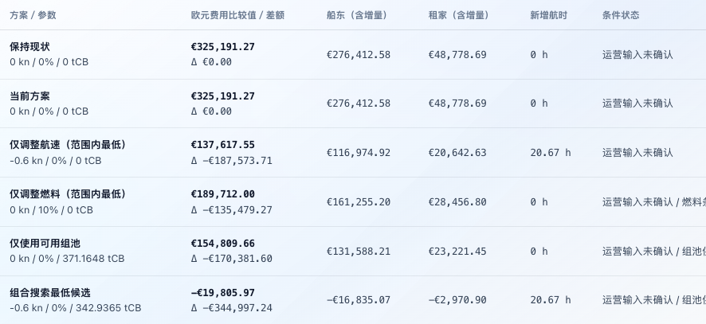 | 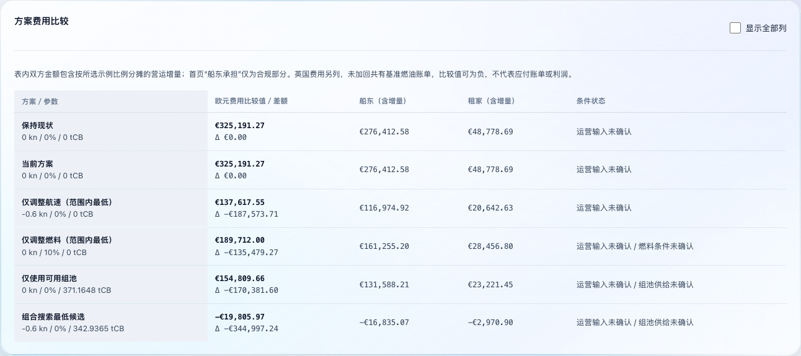 |

### 全航线 / Full route

| 改前 / Before | 改后 / After |
| --- | --- |
| 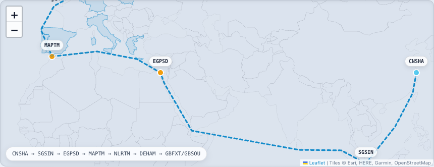 | 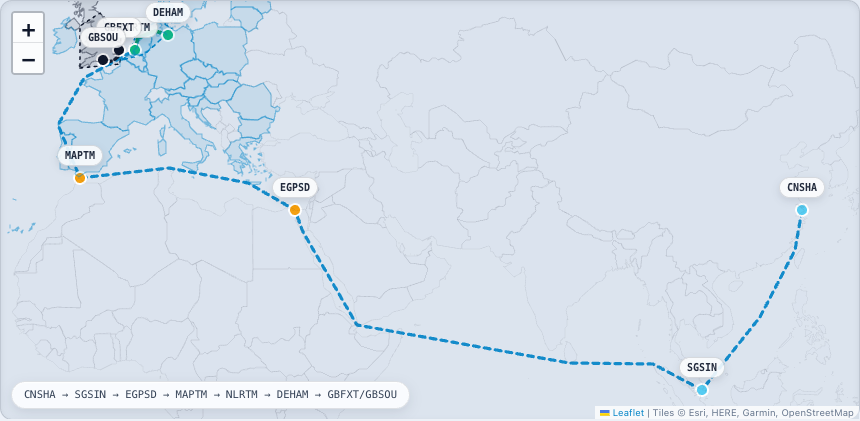 |

### 零变化环形图 / Zero-change rings

| 改前 / Before | 改后 / After |
| --- | --- |
| 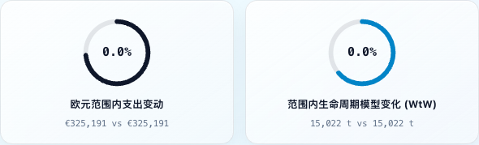 | 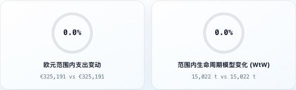 |

## 768px

### 比较表 / Comparison

| 改前 / Before | 改后 / After |
| --- | --- |
| 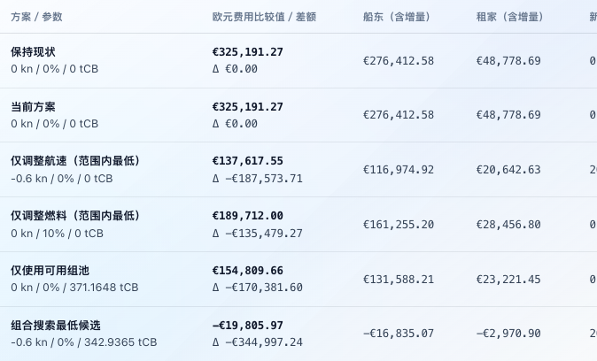 | 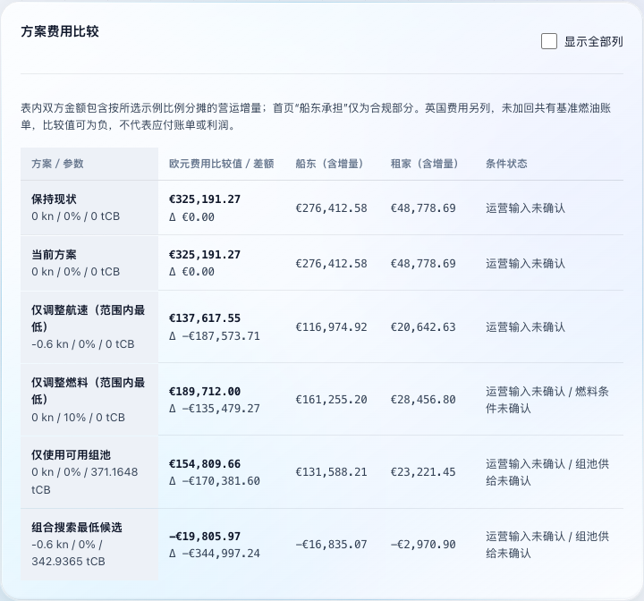 |

### 全航线 / Full route

| 改前 / Before | 改后 / After |
| --- | --- |
| 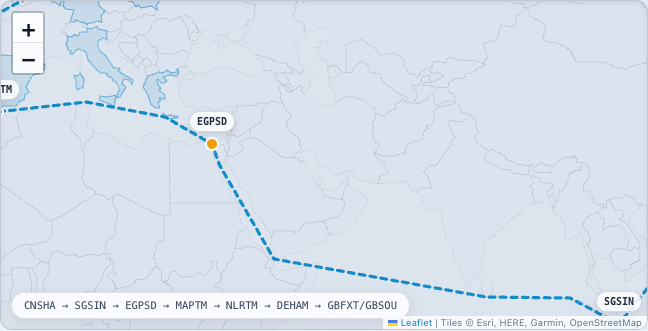 | 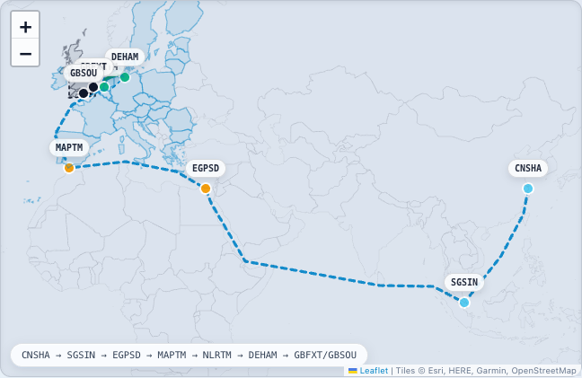 |

### 零变化环形图 / Zero-change rings

| 改前 / Before | 改后 / After |
| --- | --- |
| 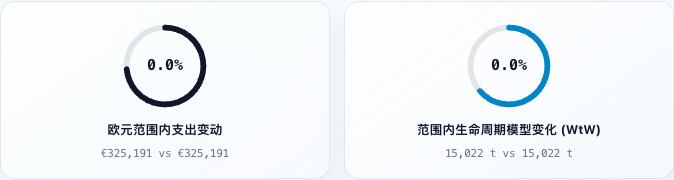 | 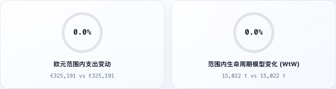 |

## 375px

### 比较表 / Comparison

| 改前 / Before | 改后 / After |
| --- | --- |
| 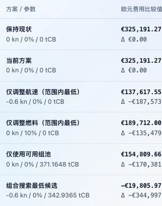 | 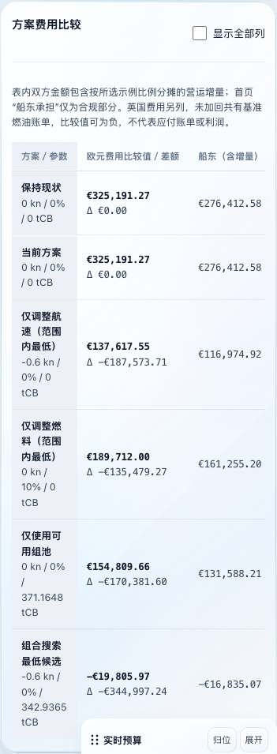 |

### 全航线 / Full route

| 改前 / Before | 改后 / After |
| --- | --- |
| 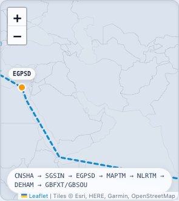 | 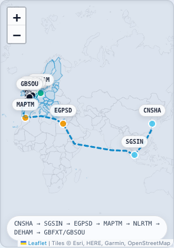 |

### 零变化环形图 / Zero-change rings

| 改前 / Before | 改后 / After |
| --- | --- |
| 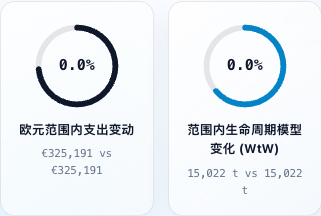 | 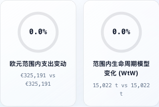 |

