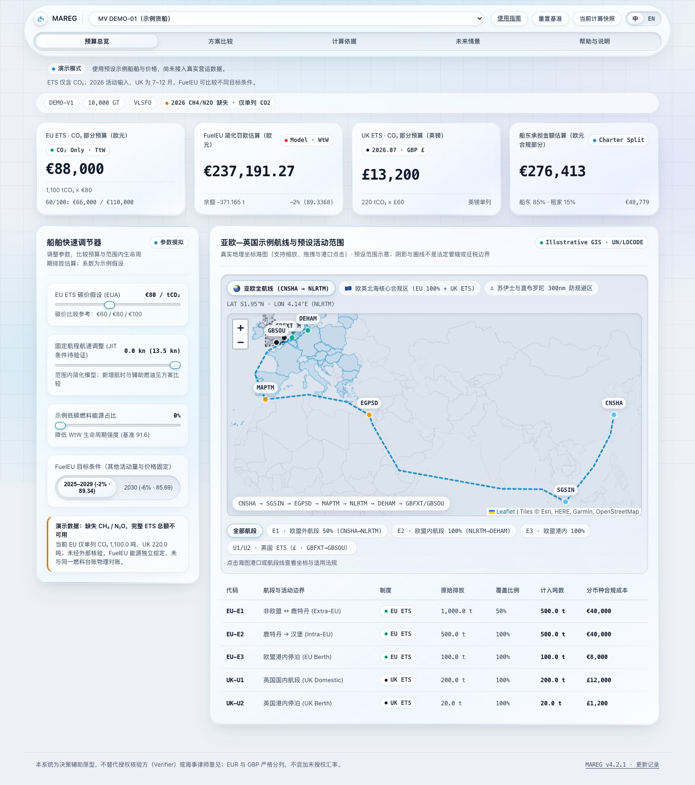
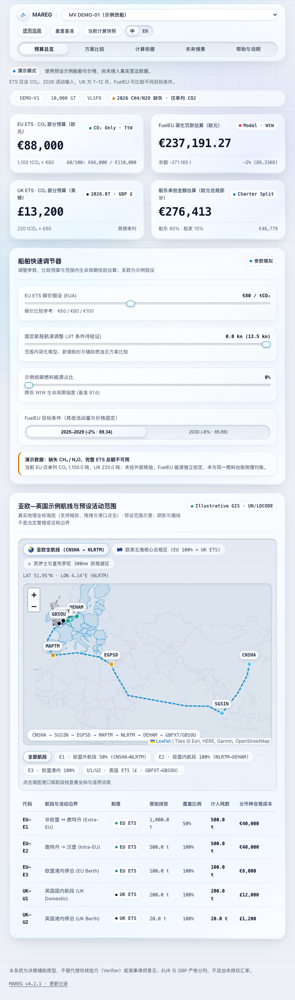
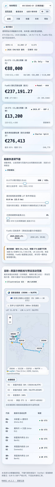
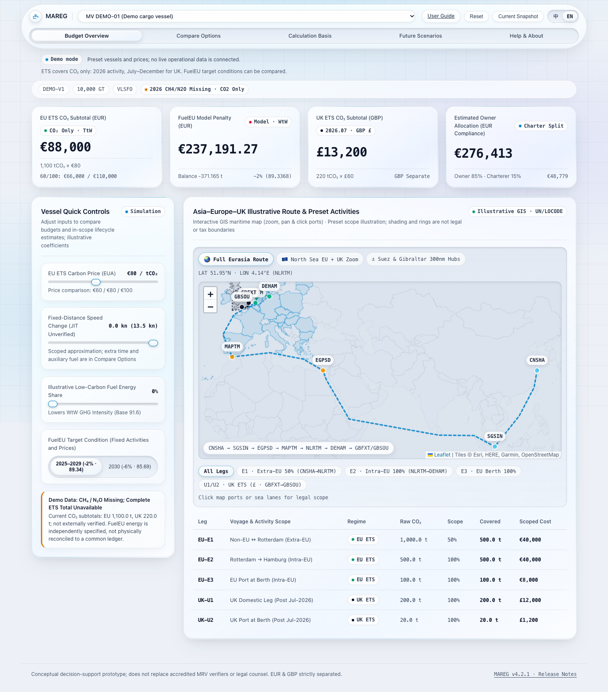
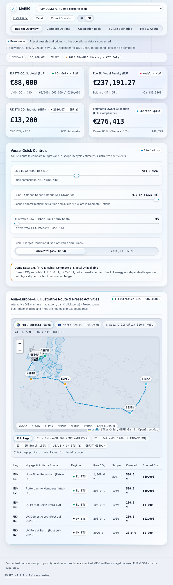
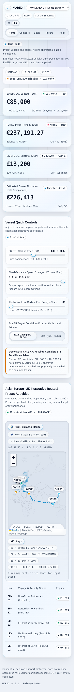

# v4.3.0 screenshots / 截图

Chrome, DPR1, viewport height 1000px. External fonts and tiles blocked; local geography retained. Infinite glows are paused at a fixed moment only for comparable screenshots; production glows/refraction remain enabled. Full-page element/table overflow stays inside its own container.

截图仅用于固定条件对照，不代表默认光斑暂停。宽表在自身区域滚动。预发布截图的页脚仍是旧 Release；正式发布后单独提交新版本链接与文字。

## CSS-only consolidation / 纯 CSS 整理

Independent commit `86d3f20`. Controlled fresh pages use original vs consolidated CSS, the same animation time and settled map. Different pixels: **1440=0, 768=0, 375=0**. Actual computed styles also match. The first captures had different pointer/map states; controlled comparison replaces those for this conclusion.

| Width | Before | After consolidation |
| --- | --- | --- |
| 1440 | [original](baseline-1440.png) | [consolidated](consolidated-1440.png) |
| 768 | [original](baseline-768.png) | [consolidated](consolidated-768.png) |
| 375 | [original](baseline-375.png) | [consolidated](consolidated-375.png) |

## Final readability / 最终可读性

Text size/contrast changes are intentional; glass, glows, refraction and display-card tilt remain.

| Width | 中文 | English |
| --- | --- | --- |
| 1440 | [中文](final-zh-1440.png) | [English](final-en-1440.png) |
| 768 | [中文](final-zh-768.png) | [English](final-en-768.png) |
| 375 | [中文](final-zh-375.png) | [English](final-en-375.png) |

### zh · 1440px

### zh · 768px

### zh · 375px

### en · 1440px

### en · 768px

### en · 375px

